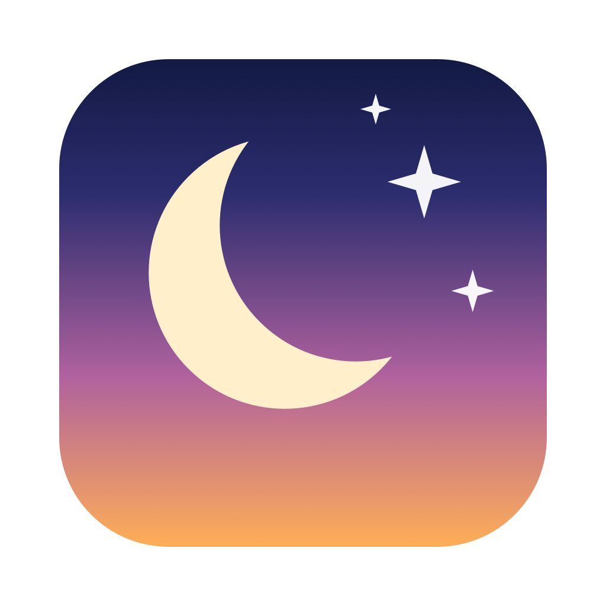

<p align="center">
  
</p>

# NightShiftCtl

[](https://github.com/workprasanth9/NightShiftCtl/actions/workflows/ci.yml)


Control macOS Night Shift from the menu bar or the command line, plus a handful
of everyday Mac toggles in one small, open source app.

- **NightShiftCtl.app**: a menu bar app with Night Shift controls, Keep Awake,
  Dark Mode, Finder toggles, Lock Screen, Empty Trash, Flush DNS and your IP address.
- **`nightshift`**: a dependency free command line tool for Terminal, scripts and MDM.

Both share the same core library (`NightShiftKit`).

## Why

Night Shift only lives in System Settings. There is no `defaults` key you can
write and no configuration profile payload for it, so Mac admins have no clean
way to set a baseline, and power users cannot script it. NightShiftCtl talks to
the same system service the Settings pane uses, so changes apply instantly and
stick. The menu bar app puts that, and the toggles people reach for every day,
one click away.

## Screenshots

> Screenshots coming soon. See [docs/screenshots](docs/screenshots).

<!--  -->

## Menu bar app features

| Section | What it does |
| --- | --- |
| Night Shift | On/off toggle, warmth slider (0 to 100), schedule picker: Off, Sunset to Sunrise, Custom times with an editor |
| True Tone | Shows whether True Tone is on (read only) |
| Keep Awake | Prevents idle sleep for 15 min, 30 min, 1, 2, 4 or 8 hours, or until turned off. Uses a standard IOKit power assertion and shows the end time |
| Dark Mode | Switches between Light and Dark appearance instantly, no permission prompt |
| Hide Desktop Icons | Hides or shows icons on the desktop (restarts Finder) |
| Show Hidden Files | Shows or hides dot files in Finder (restarts Finder) |
| Lock Screen | Locks the Mac immediately (also Cmd+L while the menu is open) |
| Empty Trash | Shows how many items are in the Trash and empties it after a confirmation |
| Flush DNS Cache | Runs `dscacheutil -flushcache` and restarts mDNSResponder behind the standard admin prompt |
| Network | Lists local IPv4 addresses, looks up the public IP on request, click any address to copy it |
| Launch at Login | Starts the app at login (macOS 13 and later) |

The menu bar icon fills in when Night Shift is on and switches to a sleeping
moon while Keep Awake is active.

### Permissions

- **Empty Trash** deletes the items in `~/.Trash` directly when macOS allows it.
  On recent macOS the Trash folder is privacy protected, so the app asks Finder
  to empty it instead, and macOS shows a one time prompt: "NightShiftCtl wants
  access to control Finder". Click **Allow**. You can change this later in
  System Settings > Privacy & Security > Automation.
- **Dark Mode** uses the same system call as System Settings, so it needs no
  permission. If that call is ever unavailable it falls back to System Events,
  which shows a similar one time prompt.
- **Flush DNS** asks for an administrator password each time.
- Everything else needs no permissions.

If you clicked **Don't Allow** earlier, reset the choice and try again:

```bash
tccutil reset AppleEvents com.workprasanth9.NightShiftCtl
```

### First launch

The first time it opens, NightShiftCtl shows a short welcome window. The app
lives in the menu bar (look for the moon icon near the clock) and has no Dock
icon. On a MacBook with a notch, a crowded menu bar can hide icons behind the
notch: quit a few menu bar apps, or hold Command and drag the moon to the right.
You can reopen the window from **Welcome and Tips...** in the menu.

### Gatekeeper: "NightShiftCtl cannot be opened"

Release builds are ad hoc signed, not notarized by Apple, so the first launch of
a downloaded copy may be blocked. To open it:

1. In Finder, open Applications, **right click** (or Control click) NightShiftCtl
   and choose **Open**, then click **Open** again in the dialog.
2. On macOS 15 and later, if there is no Open button, go to System Settings >
   Privacy & Security, scroll to the NightShiftCtl message, and click
   **Open Anyway**.

You only need to do this once. Admins deploying with Jamf can sign the app and
package with their own Developer ID (see `SIGN_ID` and `PKG_SIGN_ID` below), in
which case users see no warning.

### Left out on purpose

- **Do Not Disturb / Focus**: macOS has no public API to change Focus, and the
  older `defaults` tricks stopped working in macOS 12. Rather than ship something
  flaky, this is not included.

## Command line features

- `on`, `off`, `toggle` Night Shift instantly
- Read or set the color temperature strength from 0 to 100
- Schedule: sunset to sunrise, custom times (`22:00 07:00` or `10pm 7am`), or off
- `status` in plain text or `--json` for scripts and inventory
- Read only True Tone status

## Install

### Installer package (app and CLI)

Build `dist/NightShiftCtl-<version>.pkg`, or download it from the artifacts of
the latest [CI run](https://github.com/workprasanth9/NightShiftCtl/actions):

```bash
git clone https://github.com/workprasanth9/NightShiftCtl.git
cd NightShiftCtl
./Scripts/build-app-pkg.sh
sudo installer -pkg dist/NightShiftCtl-*.pkg -target /
open /Applications/NightShiftCtl.app
```

The package shows a short thank you page when it finishes and installs:

- `/Applications/NightShiftCtl.app`
- `/usr/local/bin/nightshift`

### App only

```bash
./Scripts/build-app.sh      # creates dist/NightShiftCtl.app
cp -R dist/NightShiftCtl.app /Applications/
```

### CLI only

```bash
swift build -c release
sudo install -m 755 "$(swift build -c release --show-bin-path)/nightshift" /usr/local/bin/nightshift
```

Xcode Command Line Tools are enough to build for your own Mac's architecture.
For universal (arm64 and x86_64) builds, install Xcode and pass `--universal` to
`build-app.sh`, `build-app-pkg.sh` or `build-release.sh`. Every CI run uploads
universal builds as artifacts.

Local builds are ad hoc signed. Set `SIGN_ID` (app) and `PKG_SIGN_ID` (package)
to your Developer ID identities to sign for distribution, then notarize as usual.

### Requirements

- macOS 12 Monterey or later (tested on macOS 26). Launch at Login needs macOS 13.
- A Mac that supports Night Shift for the Night Shift controls

## CLI usage

```text
nightshift status [--json]          Show Night Shift state, strength and schedule
nightshift on                       Turn Night Shift on now
nightshift off                      Turn Night Shift off now
nightshift toggle                   Flip the current state
nightshift strength [0-100]         Show or set the color temperature warmth
nightshift schedule                 Show the current schedule
nightshift schedule sunset          Schedule from sunset to sunrise
nightshift schedule <from> <to>     Custom schedule, for example 22:00 07:00 or 10pm 7am
nightshift schedule off             Disable the schedule
nightshift truetone [--json]        Show True Tone status (read only)
nightshift version                  Print the version
```

### Examples

```bash
$ nightshift status
Night Shift: off
Strength:    50
Schedule:    off

$ nightshift schedule 10pm 7am
Schedule: custom, 22:00 to 07:00

$ nightshift strength 70
Strength: 70

$ nightshift status --json
{
  "enabled" : false,
  "from" : "22:00",
  "schedule" : "custom 22:00-07:00",
  "strength" : 70,
  "sunSchedulePermitted" : true,
  "to" : "07:00"
}
```

Exit codes: `0` success, `1` the system refused or Night Shift is unavailable,
`2` invalid arguments.

`schedule sunset` needs Location Services enabled for
System Services > Setting time zone, the same requirement System Settings has.

## Jamf and MDM deployment

1. Build the package with `./Scripts/build-app-pkg.sh --universal` (or take it
   from the CI artifacts), sign it if you have a Developer ID Installer
   certificate, and upload it to Jamf Pro.
2. Deploy it with a policy. It installs the app to `/Applications` and the CLI
   to `/usr/local/bin`. The package is not relocatable, so it always lands in
   `/Applications` even if a user has another copy.
3. Optional: add `Jamf/Policy-SetNightShift.sh` as a script to set a Night Shift
   baseline at login (parameter 4 is the schedule, parameter 5 the strength).
4. Optional: add `Jamf/EA-NightShiftStatus.sh` as an extension attribute to see
   Night Shift state in inventory and build smart groups.

Night Shift settings belong to each user, so the CLI must run in the logged in
user's session. Jamf policies run as root, so wrap calls like this (the sample
scripts already do):

```bash
USER=$(stat -f%Su /dev/console)
launchctl asuser "$(id -u "$USER")" sudo -u "$USER" /usr/local/bin/nightshift status
```

| File | Purpose |
| --- | --- |
| `Jamf/EA-NightShiftStatus.sh` | Extension attribute, reports `on \| strength 50 \| schedule sunset-to-sunrise` |
| `Jamf/Policy-SetNightShift.sh` | Policy script that applies a schedule and strength |

To pre-approve the Automation prompts for Dark Mode and Empty Trash, deploy a
PPPC profile allowing `com.workprasanth9.NightShiftCtl` to send Apple Events to
`com.apple.systemevents` and `com.apple.finder`. This requires a signed build,
because PPPC matches the code signing requirement.

Because Night Shift cannot be enforced by a profile, users can still change it
afterwards. Re-run the policy at login if you need to keep a baseline.

## How it works and caveats

macOS has no public API for Night Shift. NightShiftCtl loads Apple's **private**
`CoreBrightness.framework` at runtime with `dlopen` and talks to its
`CBBlueLightClient` class through the Objective-C runtime, the same client System
Settings uses. Nothing is linked against private symbols at build time, and the
code checks that every method it needs exists before calling it. Lock Screen
uses `SACLockScreenImmediate` from the private `login.framework` (the same call
behind the Lock Screen menu item) and falls back to `pmset displaysleepnow`.

The other features use public mechanisms only: IOKit power assertions, Finder
preferences, AppleScript, `getifaddrs`, and `SMAppService`.

Please keep in mind:

- Private frameworks are undocumented and can change in any macOS release. If
  Apple changes them, the app and CLI report an error instead of crashing, but
  may need an update.
- This approach is not allowed in the Mac App Store. It is intended for admins,
  scripts, and personal use.
- The public IP lookup sends one request to `api.ipify.org`, only when you click
  Show Public IP.

## Development

```bash
swift build                     # debug build of everything
swift build -c release          # release build
swift test                      # unit tests (needs Xcode, XCTest is not in Command Line Tools)
./Scripts/build-app.sh          # dist/NightShiftCtl.app
./Scripts/build-app-pkg.sh      # dist/NightShiftCtl-<version>.pkg
./Scripts/make-icns.sh          # regenerate App/AppIcon.icns from Scripts/make-icon.swift
./Scripts/check-text.sh         # style check used by CI
dist/NightShiftCtl.app/Contents/MacOS/NightShiftCtl --self-test   # read only diagnostics
dist/NightShiftCtl.app/Contents/MacOS/NightShiftCtl --run-action dark-mode   # run one action (dark-mode, desktop-icons, hidden-files, trash-count, public-ip)
```

Project layout:

- `Sources/CBlueLight`: small Objective-C bridge to CoreBrightness
- `Sources/NightShiftKit`: Swift API (status, on/off, strength, schedule, parsing)
- `Sources/nightshift`: the command line tool
- `Sources/NightShiftCtlApp`: the menu bar app (AppKit)
- `App`: Info.plist, entitlements and icon for the app bundle
- `Installer`: the installer's thank you page
- `Jamf`: extension attribute and policy samples
- `Tests/NightShiftKitTests`: unit tests for parsing and conversions

## Support

NightShiftCtl is free and open source. Thank you for using it! If it saves you
a few clicks, the best way to support it is to
[star the repo on GitHub](https://github.com/workprasanth9/NightShiftCtl) and
share it with a Mac admin friend. Bug reports and ideas are just as welcome.

## Contributing

Issues and pull requests are welcome. If a macOS update breaks something,
please open an issue with your macOS version and the output of
`nightshift status` or `NightShiftCtl --self-test`.

## License

MIT, see [LICENSE](LICENSE).
